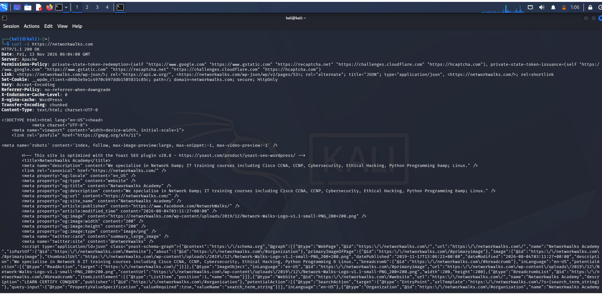
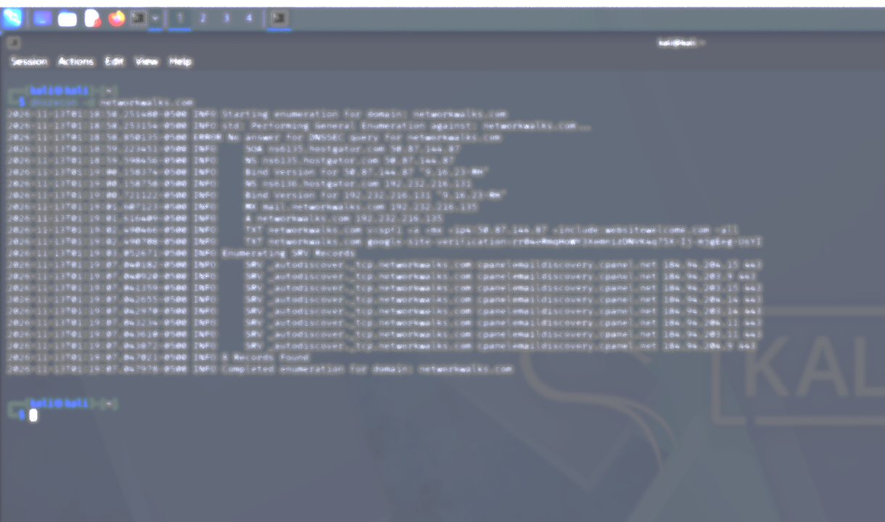
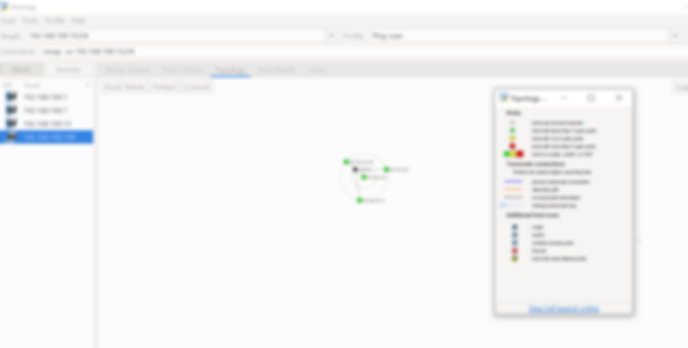

# 🔐 Web Reconnaissance & Network Scanning

**Performing information gathering, web technology fingerprinting, DNS enumeration, and network scanning using Kali Linux.**

<p align="center">
  
  
  
  
  
  
  
</p>

---

## 📌 Project Overview

This project focuses on practicing **Information Gathering (Reconnaissance)** and **Network Scanning** using various tools available in Kali Linux.

The practical activities were divided into two main modules:
W2-PM1: Information Gathering & Web Reconnaissance using Kali Linux Tools
W2-PM3: Information Gathering using Maltego
W2-PM4: Information Gathering & Web Reconnaissance using theHarvester
W2-PM5: Network Scanning using Zenmap

The first module involved gathering information about a target domain, identifying web technologies, inspecting HTTP response headers, and querying DNS records.

The second module focused on scanning the local area network (LAN) to discover active devices and identify open ports.

These exercises provided practical experience in understanding how reconnaissance techniques support the initial stages of a penetration testing assessment.

---

## 🎯 Objectives

The main objectives of this project are to:
- Perform DNS lookups and identify domain IP addresses.
- Identify web technologies using WhatWeb.
- Inspect HTTP response headers using cURL.
- Enumerate DNS information using dnsrecon.
- Gather publicly available information using theHarvester.
- Perform OSINT and investigate relationships using Maltego.
- Understand the information exposed by web infrastructure.
- Discover active devices within a local network.
- Perform network scanning using Zenmap.

Practice network reconnaissance using Kali Linux tools.
---

## 🛡️ Purpose of the Project

Reconnaissance is an important initial phase of penetration testing. It helps security professionals understand the target environment before conducting further security assessments.

This project focuses on developing practical skills in:

- DNS Enumeration
- Web Technology Fingerprinting
- HTTP Header Analysis
- Information Gathering
- Network Host Discovery
- netwok Scanning

⚠️ **Important:** All scanning and testing activities must be performed only against systems and networks that you own or have explicit authorization to assess.

---

## ⚙️ Tools & Technologies

| 🧩 Tool | 🎯 Purpose |
|---|---|
| Kali Linux | Security testing environment |
| Nslookup | DNS lookup and IP resolution |
| WhatWeb | Web technology fingerprinting |
| cURL | HTTP header inspection |
| dnsrecon | DNS information enumeration |
| Zenmap | Network scanning and visualization |
| Nmap | Host discovery and port scanning |
| Maltego | OSINT investigation and relationship mapping |
| theHarvester | Public information gathering and email/subdomain enumeration |

# 🪜 Practical Implementation

## Module W2-PM4: Information Gathering & Web Reconnaissance

This module focused on collecting information about the target domain `networkwalks.com` using different reconnaissance utilities available in Kali Linux.

### 1. DNS Lookup (Nslookup)

**Tool:** Nslookup

The `nslookup` command was used to query DNS information and identify the IP address associated with the target domain.

**Command:**

```bash
nslookup networkwalks.com
```

**Result:**

Successfully resolved the domain name to its corresponding IP address.

**Screenshot:**
  

**Key Concept:**

DNS resolution translates human-readable domain names into IP addresses that computers use to communicate over networks.

---

### 2. Web Technology Fingerprinting (WhatWeb)

**Tool:** WhatWeb

WhatWeb was used to identify technologies and software components associated with the target website.

**Command:**

```bash
whatweb networkwalks.com
```

**Result:**

Identified information about the web server technologies and Content Management System (CMS) used by the website.

**Screenshot:**
    


**Key Concept:**

Technology fingerprinting helps security professionals understand the technologies running behind a website and identify potential areas for further security assessment.

---

### 3. HTTP Header Inspection (cURL)

**Tool:** cURL

The `curl` utility was used to inspect the HTTP response headers returned by the target web server.

**Command:**

```bash
curl -I https://networkwalks.com
```

**Result:**

Retrieved the HTTP response headers and checked the server response status and available header information.

**Screenshot:**
 
**Key Concept:**

HTTP headers can reveal useful information about server behavior, response configuration, and potentially exposed technologies.

---

### 4. DNS Records Enumeration (Dig)

**Tool:** dnsrecon -d

The `dnsrecon -d` command was used to query DNS information associated with the target domain.

**Command:**

```bash
dnsrecon -d networkwalks.com
```

**Result:**

Queried the DNS server for available DNS record information associated with the domain.

**Screenshot:**
 

**Key Concept:**

DNS enumeration helps security professionals understand domain configuration and gather information about the target's DNS infrastructure.
---
### 5. Information Gathering & Email Enumeration (theHarvester)

**Tool:** theHarvester
The theHarvester tool was used to gather publicly available information associated with the target domain, including email addresses, subdomains, hostnames, and other relevant information.
**Command:**

```bash
theHarvester -d networkwalks.com -b all
```

**Result:**

Collected publicly available information associated with the target domain to identify potential email addresses, subdomains, and related infrastructure.

**Screenshot:**
 

**Key Concept:**

theHarvester is an OSINT tool used by security professionals during the reconnaissance phase to collect publicly available information about a target organization or domain.
---
### 6. Maltego — Information Gathering & Email Reconnaissance

**Tool:** Maltego
Maltego was used to perform OSINT-based reconnaissance and investigate relationships between publicly available information associated with a target email address..
**Method:**

```bash
Created a new Maltego investigation.
Added the target email address as an entity.
Executed relevant transforms to gather associated information.
Analyzed the results to identify relationships and connected entities.
```

**Result:**

The investigation returned information related to the target email address and its associated digital footprint.

**Screenshot:**
 

**Key Concept:**

Maltego helps security professionals perform OSINT investigations by discovering and visualizing relationships between entities such as email addresses, domains, people, IP addresses, and websites.
---
## Module W2-PM5: Network Scanning with Zenmap

This module focused on discovering active devices and identifying open ports within the local area network (LAN).

**Tool:** Zenmap (Nmap GUI)

### Scan Configuration

| 🧩 Parameter | ⚙️ Configuration |
|---|---|
| Target Scope | Local Area Network (LAN) |
| Scanning Tool | Zenmap |
| Scan Types |Ping Scan |
| Main Objective | Host Discovery |

### Scanning Procedure

1. Install and opened Zenmap.
2. Specified the local network as the scan target.
3. Selected the appropriate scanning profile.
4. Executed the scan to discover active devices.
5. Reviewed the scan results to identify available hosts and open ports.

### Summary of Findings

The local network was successfully scanned, and active devices connected to the network were identified.

The scan also helped identify open ports on the discovered devices.

**Screenshot:**
 
**Key Concept:**

Network scanning helps security professionals map network environments, discover active hosts, and identify accessible services.

---

## 🔎 Results & Findings

The following table summarizes the activities performed during the practical exercises:

| 🔍 Activity | 🛠️ Tool | ✅ Result |
1. Information Gathering & OSINT
Activity	Tool	Result
DNS Lookup	Nslookup	Domain resolved to an IP address
DNS Enumeration	dnsrecon	DNS records and domain information queried
Email & Subdomain Enumeration	theHarvester	Publicly available email addresses, subdomains, and host information gathered
OSINT & Email Reconnaissance	Maltego	Relationships and information associated with the target email address identified

2. Web Reconnaissance
Activity	Tool	Result
Technology Fingerprinting	WhatWeb	Web technologies and CMS identified
HTTP Header Inspection	cURL	HTTP response headers retrieved

3. Network Scanning & Discovery
Activity	Tool	Result
Host Discovery	Zenmap	Active local network devices identified
Port Scanning	Zenmap	Open ports identified

---

## 💡 What I Learned

Through these practical exercises, I gained a better understanding of reconnaissance techniques and network scanning.

The most important concepts I learned include:

### 1. DNS Enumeration

I learned how DNS lookup utilities such as Nslookup and Dig can be used to retrieve domain-related information and understand DNS resolution.

### 2. Web Technology Fingerprinting

I learned how WhatWeb identifies technologies and software components used by websites, which can help during the initial information-gathering phase.

### 3. HTTP Header Analysis

I learned how to retrieve and inspect HTTP response headers using cURL and understand the information that web servers expose through their responses.

### 4. Network Host Discovery

I gained practical experience using Zenmap to discover active devices within a local network and understand how network scanning identifies connected hosts.

### 5. Port Scanning

I learned how port scanning helps identify open ports on discovered devices, providing useful information about potentially accessible network services.

### 6. Reconnaissance Methodology

I understood how different information-gathering tools complement one another during the reconnaissance phase of a penetration testing assessment.

---

## 🔐 Security & Ethical Use

These activities were conducted for educational purposes as part of the NetworkWalks cybersecurity training program.

All network scanning activities should remain within authorized testing environments and approved network scopes.

The information gathered during reconnaissance should be handled responsibly and used only for legitimate security assessment purposes.

---

## 👤 Author

**Irshad Hussain**

Cybersecurity Student 

---

## 📌 Project Information

- **Program:** Cybersecurity Internship | NetworkWalks
- **Week:** 02
- **Module W2-PM4:** Information Gathering & Web Reconnaissance
- **Module W2-PM5:** Network Scanning with Zenmap
- **Environment:** Kali Linux
- **Focus:** Web Reconnaissance & Network Scanning

